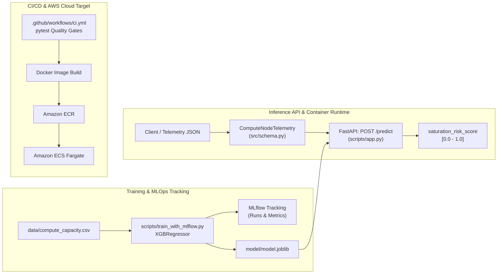

# Cloud Compute Node Saturation Risk MLOps Pipeline

Production-minded MLOps pipeline predicting cloud compute node saturation risk (`saturation_risk_score` in `[0.0, 1.0]`) using **XGBoost**, **MLflow**, **FastAPI**, **Docker**, **Amazon ECR**, and **Amazon ECS Fargate**, backed by automated `pytest` quality gates.

## Architecture Diagram



## ML & MLOps Principles

- **Supervised Regression Model**: Trains an `XGBRegressor` on node telemetry features (`cpu_utilization_pct`, `memory_utilization_pct`, `request_rate_rps`, `p99_latency_ms`, `queue_depth`, `uptime_hours`) to predict `saturation_risk_score` in `[0.0, 1.0]`.
- **Reproducibility & Artifact Gate**: Tracks training runs in `MLflow`, exports `model/model.joblib`, and verifies model loading/inference before release.
- **Contract & API Reliability**: Enforces schema validation via `ComputeNodeTelemetry` in `src/schema.py` on `POST /predict` to reject invalid telemetry early.
- **Automated CI & Container Readiness**: Runs `pytest` suites (`test_api_contract.py`, `test_mlops_quality.py`, `test_model_gate.py`, `test_smoke.py`) and validates the `Docker` build for `Amazon ECR` and `Amazon ECS Fargate`.

## Local Commands

```powershell
.\venv\Scripts\python.exe scripts\train_with_mlflow.py
.\venv\Scripts\python.exe -m pytest -v
```

## Sample POST /predict Payload

```json
{
  "cpu_utilization_pct": 82.5,
  "memory_utilization_pct": 76.0,
  "request_rate_rps": 1450.0,
  "p99_latency_ms": 185.0,
  "queue_depth": 24,
  "uptime_hours": 312.0
}
```