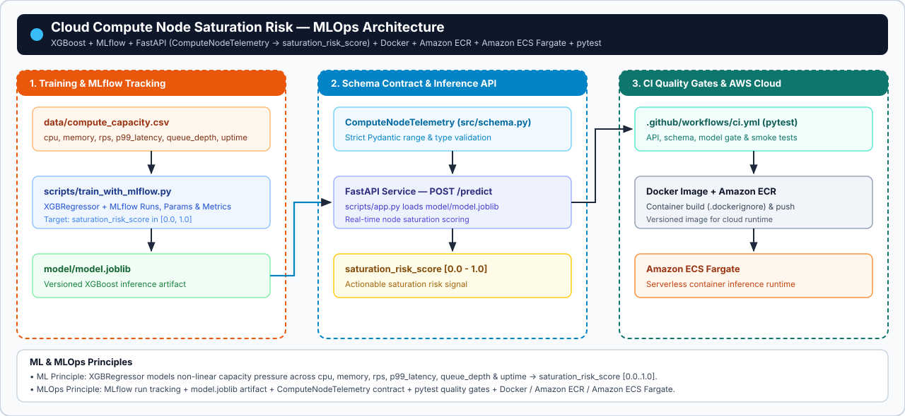

# Cloud Compute Node Saturation Risk MLOps Pipeline

[](https://github.com/TechBsf/node-saturation-mlops/actions/workflows/ci.yml)


End-to-end MLOps pipeline predicting cloud compute node saturation risk (`saturation_risk_score` in `[0.0, 1.0]`) with **XGBoost**, **MLflow**, **FastAPI**, **Docker**, **Amazon ECR** and **Amazon ECS Fargate**, gated by automated `pytest` quality checks.

## Architecture



## Results

Evaluated on a held-out test set (20 % of the data, `random_state=42`).

| Model | RMSE | MAE | R² |
|---|---|---|---|
| Baseline (mean predictor) | 0.0864 | 0.0700 | -0.0005 |
| Linear Regression | 0.0302 | 0.0237 | 0.8778 |
| XGBRegressor (final) | 0.0314 | 0.0245 | 0.8678 |

Both models are far better than the mean baseline (R² ≈ 0.87-0.88). Linear regression and XGBoost are within ~4 % RMSE of each other on this dataset, which suggests the target is close to linear in the features here. XGBoost is kept as the production model for its ability to capture non-linear interactions on real telemetry (see Roadmap: cross-validation and tuning). All runs, parameters and metrics are tracked in MLflow.

> Data: `data/compute_capacity.csv` is **synthetic**, generated to mimic node telemetry.

## Quick Start

```bash
# 1. Build the image
docker build -t saturation-risk-api .

# 2. Run the API
docker run -p 8000:8000 saturation-risk-api

# 3. Call the endpoint
curl -X POST http://localhost:8000/predict \
  -H "Content-Type: application/json" \
  -d '{"cpu_utilization_pct": 85, "memory_utilization_pct": 78, "request_rate_rps": 1200, "p99_latency_ms": 450, "queue_depth": 40, "uptime_hours": 320}'
```

The response is a JSON object with a `saturation_risk_score` between 0.0 and 1.0.

Interactive API docs (Swagger): `http://localhost:8000/docs`

## Deployment (AWS)

The container image is pushed to **Amazon ECR** and served on **Amazon ECS Fargate** (serverless containers, no instance management).


## ML & MLOps Principles

- **Supervised Regression Model**: `XGBRegressor` trained on node telemetry (`cpu_utilization_pct`, `memory_utilization_pct`, `request_rate_rps`, `p99_latency_ms`, `queue_depth`, `uptime_hours`) to predict `saturation_risk_score` in `[0.0, 1.0]`.
- **Reproducibility & Artifact Gate**: training runs tracked in `MLflow`, model exported to `model/model.joblib`, loading and inference verified before release.
- **Contract & API Reliability**: strict schema validation via `ComputeNodeTelemetry` (`src/schema.py`) on `POST /predict` rejects invalid telemetry early.
- **Automated CI & Container Readiness**: `pytest` suites (`test_api_contract.py`, `test_mlops_quality.py`, `test_model_gate.py`, `test_smoke.py`) and Docker build validated for Amazon ECR / ECS Fargate.

## Design Decisions & Limitations

- **Why XGBoost**: handles non-linear interactions between load signals and scales to richer telemetry. On the current dataset a linear model performs equally well, so the gain is not demonstrated yet; this is tracked in the Roadmap.
- **Why ECS Fargate over EKS**: a single inference service does not justify Kubernetes operational overhead.
- **Limitations**: synthetic data, no live traffic, no drift monitoring yet.

## Roadmap

- [ ] 5-fold cross-validation and hyperparameter tuning to compare XGBoost and linear fairly
- [ ] Data drift monitoring (Evidently)
- [ ] MLflow Model Registry with staged promotion
- [ ] CD workflow: automatic push to ECR and ECS deploy on merge
- [ ] Input data validation (Great Expectations / Pandera)

## Repository Structure

```text
.
├── data/                 # compute_capacity.csv
├── docs/                 # architecture diagram, screenshots
├── model/                # model.joblib
├── scripts/              # train_with_mlflow.py, app.py
├── src/                  # schema.py
├── tests/                # pytest suites
├── .github/workflows/    # ci.yml
└── Dockerfile
```

## Local Commands

```powershell
.\venv\Scripts\python.exe scripts\train_with_mlflow.py
.\venv\Scripts\python.exe -m pytest -v
```