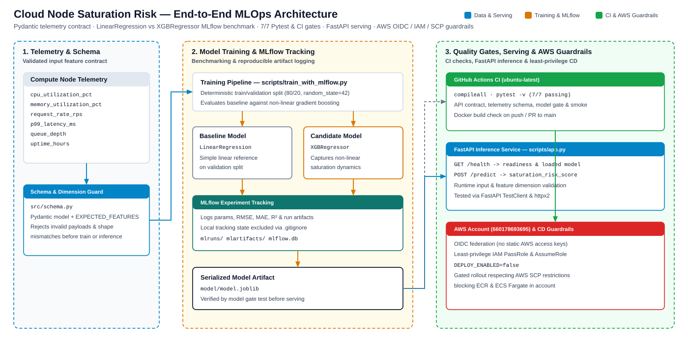

# Cloud Node Saturation MLOps

End-to-end MLOps pipeline for predicting cloud node saturation (`saturation_risk_score`) from infrastructure telemetry (`cpu_utilization_pct`, `memory_utilization_pct`, `request_rate_rps`, `p99_latency_ms`, `queue_depth`, `uptime_hours`).



---

## Key Highlights

- **Reproducible Training & Tracking**: baseline (`LinearRegression`) vs candidate (`XGBRegressor`) benchmarked with **MLflow** (`scripts/train_with_mlflow.py`), logging parameters, metrics (`RMSE`, `MAE`, `R²` on validation *and* test) and model artifacts (`model/model.joblib`) with signature + input example.
- **Data & Inference Validation**: schema and dimension validation (`src/schema.py` and `scripts/app.py`) before training and serving. Feature order is defined once in `src/schema.py` and reused everywhere to avoid train/serve skew.
- **Serving API**: real-time inference API built with **FastAPI** (`scripts/app.py`) exposing `/health` and `/predict` (bounded `saturation_risk_score` in `[0, 1]`).
- **Automated Quality Gates**: unit/contract/model-gate tests via **pytest** (`tests/`) plus lint (`ruff`), type-checking (`mypy`), training, and a **container smoke test** in CI (`.github/workflows/ci.yml`).
- **Cloud-Aware Deployment Design**: SageMaker training scripts (`run_training_job.py`, `create_pipeline.py`, `run_train_deploy.py`) plus an ECS Fargate CD workflow (`deploy.yml`) guarded by `DEPLOY_ENABLED` and GitHub OIDC, to handle organizational **AWS SCP** restrictions on **ECR** and **ECS Fargate**.
- **Deterministic Splits**: training, validation and test use the shared 70/15/15 helper with seed `42`; all benchmark scripts evaluate the same test split.
- **Model Promotion Gate**: only a candidate at least 1% better in validation RMSE replaces the linear baseline in `model/model.joblib`.
- **Training Data Validation**: missing values, non-numeric columns, infinite values and target values outside `[0,1]` fail before model training.
- **Model Manifest**: `model/model_metadata.json` records selected model, dataset hash, split, gate and test metrics.

---

## Repository Structure

```text
.
├── .github/
│   └── workflows/             # GitHub Actions CI & CD
├── docs/                      # Architecture diagrams
├── iam/                       # IAM trust & PassRole policies
├── scripts/
│   ├── app.py                 # FastAPI inference API (/health, /predict)
│   ├── train_with_mlflow.py   # Baseline vs XGBoost + MLflow tracking
│   ├── compute_baselines.py   # Offline benchmark table
│   ├── run_training_job.py    # SageMaker training job (SKLearn)
│   ├── create_pipeline.py     # SageMaker pipeline
│   └── run_train_deploy.py    # SageMaker built-in XGBoost train + deploy
├── src/
│   ├── schema.py              # Feature/TARGET contract + Pydantic model
│   ├── data/processing.py     # CSV loading helpers
│   └── models/                # evaluation + inference helpers
├── tests/                     # Pytest suite
├── data/                      # compute_capacity.csv
├── model/                     # trained model (not committed; train first)
├── Dockerfile                 # API image
├── requirements.txt           # runtime deps only
├── pyproject.toml             # packaging, deps, lint/type config
├── Makefile                   # common dev tasks
└── README.md
```

---

## Quickstart

### 1. Setup

```bash
python -m venv .venv
# Windows : .venv\Scripts\activate    # macOS/Linux : source .venv/bin/activate
pip install -e ".[dev]"
```

### 2. Train

```bash
python scripts/train_with_mlflow.py
```

This fits `XGBRegressor` on `data/compute_capacity.csv` and writes `model/model.joblib`.
Optionally enable MLflow tracking:

```bash
export MLFLOW_TRACKING_URI=file:///path/to/mlruns   # or your tracking server
python scripts/train_with_mlflow.py
```

### 3. Serve

```bash
uvicorn scripts.app:app --host 0.0.0.0 --port 8000
```

- `GET  /health` → `{"status": "ok"}`
- `POST /predict` with either a full telemetry object or a `{"features": [...]}` vector.
- `GET  /ready` → readiness status; returns `503` until the model is loaded.
- `GET  /metrics` → prediction count, error count, last score and average latency.
- `GET  /drift` → rolling feature drift report; becomes active after 30 predictions.

### 4. Test, lint, type-check

```bash
pytest -v
ruff check .
mypy .
```

Or use the Makefile targets: `make install`, `make train`, `make test`, `make lint`, `make typecheck`, `make api`.

### 5. Docker

```bash
docker build -t cloud-node-saturation-mlops .
docker run -p 8000:8000 cloud-node-saturation-mlops
```

> The model must exist locally (`make train`) before building, since `model/model.joblib` is not committed.

### 6. Deploy (SageMaker / ECS)

SageMaker scripts read configuration from the environment (`AWS_REGION`, `S3_BUCKET`, `SAGEMAKER_ROLE_ARN`); copy `.env.example` to `.env` and fill in your values.

The ECS CD workflow is off by default. To enable it, set these repository variables/secret:

- `DEPLOY_ENABLED=true`
- `DEPLOY_ROLE_ARN` (the OIDC role ARN used by `deploy.yml`)

---

## Known constraints

- The target AWS account restricts **Amazon ECR** and **ECS Fargate** via SCP; the ECS CD workflow stays disabled (`DEPLOY_ENABLED=false`) until that changes.
- The dataset is a small synthetic CSV (1500 rows); a real deployment should add data versioning (DVC/S3) and drift monitoring.
