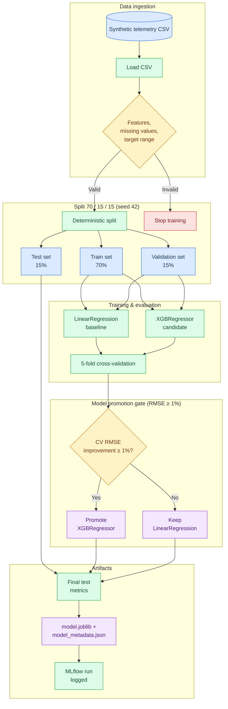
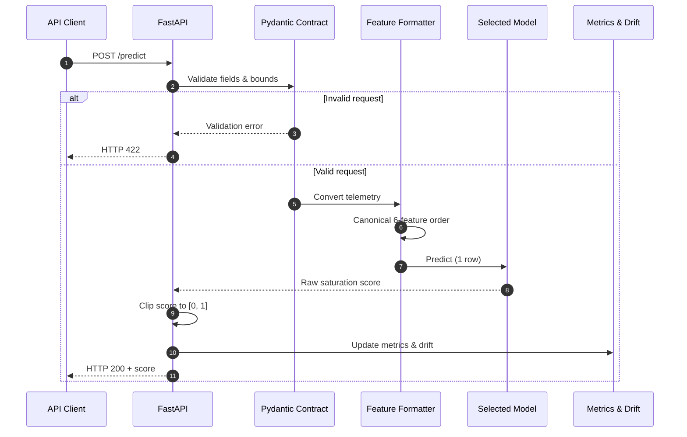

# Cloud Node Saturation MLOps

End-to-end MLOps pipeline for predicting cloud node saturation risk (`saturation_risk_score`) from infrastructure telemetry (CPU utilization, memory utilization, request rate, P99 latency, queue depth, uptime). The project compares a `LinearRegression` baseline against an `XGBRegressor` candidate, applies a model promotion gate (RMSE improvement ≥ 1%), and exposes a real-time inference API via FastAPI.

Designed for reproducibility, train/serve anti-skew, and cloud-aware deployment (SageMaker / ECS Fargate).

---

## Project Scope & Status

| Item | Detail |
|------|--------|
| **Maturity** | Functional prototype (version 0.1.0), local training validated, unit tests passing |
| **Dataset** | `data/compute_capacity.csv` — synthetic CSV with 1,500 rows (not committed; generated locally) |
| **Selected model** | `LinearRegression` (XGBoost rejected by the gate: RMSE improvement < 1%) |
| **Model artifacts** | `model/model.joblib` + `model/model_metadata.json` — **not committed**; must be trained before use |
| **Cloud deployment** | SageMaker scripts and ECS Fargate workflow present, **not executed locally** (require AWS credentials and existing infrastructure) |
| **Known constraints** | ECR and ECS Fargate restricted by SCP on the target AWS account; CD workflow disabled by default (`DEPLOY_ENABLED=false`) |
| **MLflow tracking** | Optional, local storage by default; no remote server configured |

---

---

## Architecture

### 1. Training and model selection



### 2. Real-time inference



### 3. CI and deployment

```mermaid
flowchart LR
    %% CI Pipeline
    subgraph CI["GitHub Actions CI"]
        PR["Push / Pull Request"] --> DEPS["Install pinned\ndependencies"]
        DEPS --> QUALITY["Ruff + mypy\nquality gates"]
        QUALITY --> TRAIN["Train & evaluate\nmodel"]
        TRAIN --> TEST["Pytest suite\n29 tests"]
        TEST --> GATE{"All checks\npassed?"}
    end

    %% Gate
    GATE -->|"No"| STOP["Pipeline stopped"]
    GATE -->|"Yes"| CI_BUILD["Build Docker image"]
    CI_BUILD --> CI_SMOKE["Smoke test:\n/ready + /predict"]
    CI_SMOKE --> CI_UPLOAD["Upload model\nartifact"]

    %% CD Deployment
    subgraph CD["Deployment (ECS Fargate)"]
        CI_UPLOAD --> ENABLED{"DEPLOY_ENABLED\n= true?"}
        ENABLED -->|"No"| DISABLED["Deployment\ndisabled"]
        ENABLED -->|"Yes"| OIDC["GitHub OIDC\ncredentials"]
        OIDC --> ECR["Build & push to\nAmazon ECR"]
        ECR --> ECS["Deploy to\nECS Fargate"]
    end

    classDef source fill:#DBEAFE,stroke:#2563EB,color:#1E3A5F
    classDef check fill:#FEF3C7,stroke:#D97706,color:#78350F
    classDef good fill:#DCFCE7,stroke:#16A34A,color:#14532D
    classDef stop fill:#FEE2E2,stroke:#DC2626,color:#7F1D1D
    classDef cloud fill:#E0F2FE,stroke:#0284C7,color:#0C4A6E

    class PR,DEPS,QUALITY,TRAIN,TEST source
    class GATE,CI_BUILD,CI_SMOKE,CI_UPLOAD,ENABLED check
    class STOP stop
    class OIDC,ECR,ECS cloud
    class DISABLED stop
```



---

### Key Components

| Component | File | Role |
|-----------|------|------|
| Feature contract | `src/schema.py` | Ordered list of 6 features + Pydantic schema with bounds (single source of truth for anti-skew) |
| Data loading & validation | `src/data/processing.py` | CSV reading (comma or semicolon separator), validation of missing values, numeric types, finite values, target in `[0, 1]` |
| Deterministic split | `src/data/splitting.py` | 70% train / 15% validation / 15% test, `random_state=42` |
| Evaluation & cross-validation | `src/models/evaluation.py` | RMSE, MAE, R²; 5-fold CV |
| Model selection | `src/models/model_selection.py` | Gate: candidate replaces baseline if RMSE improves by at least 1% |
| Drift detection | `src/models/drift.py` | Z-score vs reference statistics, threshold 3.0 |
| Inference preparation | `src/models/inference.py` | Converts Pydantic model to numpy array, feature order guaranteed |
| Serving API | `scripts/app.py` | FastAPI: `/health`, `/ready`, `/predict`, `/metrics`, `/drift` |
| Training + MLflow | `scripts/train_with_mlflow.py` | Baseline vs candidate, gate, model save, manifest, optional MLflow logging |
| Offline benchmark | `scripts/compute_baselines.py` | Comparison of DummyRegressor / LinearRegression / selected model |
| SageMaker Pipeline | `scripts/create_pipeline.py` | SageMaker pipeline (SKLearn estimator) |
| SageMaker Job | `scripts/run_training_job.py` | Standalone SageMaker training job |
| SageMaker XGBoost | `scripts/run_train_deploy.py` | Training + endpoint deployment with built-in XGBoost |

---

## What This Project Demonstrates

- **Data contracts:** one canonical feature order shared between training and inference.
- **Data validation:** missing values, non-numeric values, infinite values and
  out-of-range targets fail before training.
- **Reproducible evaluation:** deterministic `70/15/15` split, seed `42`,
  5-fold cross-validation and a held-out test set.
- **Model promotion:** cross-validation metrics decide whether XGBoost replaces
  the linear baseline.
- **Artifact traceability:** the model manifest records the dataset hash, split,
  selected model, reference statistics and test metrics.
- **Serving:** FastAPI exposes liveness, readiness, prediction, operational
  metrics and a lightweight rolling drift report.
- **Delivery:** GitHub Actions runs tests and builds Docker; the trained artifact
  is transferred to the ECS deployment workflow.
- **Cloud portability:** SageMaker training and deployment alternatives are
  included, while ECS is disabled by default.

---

## Model and Evaluation

The test set is held out from training and from the candidate-selection gate.
The final test metrics below describe the model selected by cross-validation.

| Model | Hold-out validation RMSE | Hold-out validation R² | Test RMSE | Test R² |
|---|---:|---:|---:|---:|
| LinearRegression | 0.0291 | 0.8968 | 0.0304 | 0.8737 |
| XGBRegressor | 0.0290 | 0.8976 | — | — |

The 5-fold gate uses cross-validation on train plus validation data:

| Model | Mean CV RMSE |
|---|---:|
| LinearRegression | 0.029277 |
| XGBRegressor | 0.030894 |

XGBoost does not improve cross-validation RMSE by at least `1%`, so the
promotion gate rejects it and deployable artifacts contain
`LinearRegression`.

At final local validation, the complete pytest suite had `29 passed` tests.

The machine-readable outcome is stored in
[`model/model_metadata.json`](model/model_metadata.json).

---

## API

| Method | Endpoint | Purpose |
|---|---|---|
| `GET` | `/health` | Process liveness |
| `GET` | `/ready` | Model readiness |
| `GET` | `/metrics` | Prediction count, errors and latency |
| `GET` | `/drift` | Rolling Z-score report by feature |
| `POST` | `/predict` | Saturation-risk inference |

### Predict with a telemetry object

```bash
curl -X POST http://localhost:8000/predict \
  -H "Content-Type: application/json" \
  -d '{
    "cpu_utilization_pct": 57.48,
    "memory_utilization_pct": 48.94,
    "request_rate_rps": 200.15,
    "p99_latency_ms": 32.16,
    "queue_depth": 4,
    "uptime_hours": 1602
  }'
```

The response is bounded to the contract range:

```json
{"saturation_risk_score": 0.35}
```

The API also accepts a `{"features": [...]}` vector when the canonical six
feature values are supplied in the order documented by
[`src/schema.py`](src/schema.py).

---

## Repository Structure

```text
.github/workflows/       CI and ECS/CD workflows
src/
  data/                  CSV loading, validation and deterministic splits
  models/                Metrics, model gate, inference and drift monitoring
  schema.py              Canonical feature and target contract
scripts/
  app.py                 FastAPI application
  train_with_mlflow.py   Baseline/candidate training and model selection
  run_training_job.py    SageMaker SKLearn training job
  create_pipeline.py     SageMaker pipeline
  run_train_deploy.py    Built-in SageMaker XGBoost example
tests/                   Unit, contract, model and API tests
data/                    Synthetic telemetry dataset
model/                   Generated model and metadata; model binary is not committed
iam/                     SageMaker role and trust policy examples
docs/                    Architecture documentation
Dockerfile               API container
pyproject.toml           Package metadata and tool configuration
```

---

## Quickstart

### 1. Create an environment

```bash
python -m venv .venv

# Windows
.venv\Scripts\activate

# macOS/Linux
# source .venv/bin/activate

python -m pip install --upgrade pip
pip install -e ".[dev]"
```

### 2. Train and select the model

```bash
python scripts/train_with_mlflow.py
```

This creates `model/model.joblib` and `model/model_metadata.json`.

Optional MLflow server/tracking URI:

```bash
# Windows PowerShell
$env:MLFLOW_TRACKING_URI="file:///C:/path/to/mlruns"

# macOS/Linux
# export MLFLOW_TRACKING_URI=file:///path/to/mlruns
```

The application does not load `.env` files automatically. Export AWS variables
for the SageMaker scripts or configure them in GitHub Actions/Secrets.

### 3. Run the API

```bash
uvicorn scripts.app:app --host 0.0.0.0 --port 8000
```

Open `http://localhost:8000/docs` for the interactive OpenAPI interface.

### 4. Test and validate

```bash
pytest -v
ruff check .
mypy src
```

The Docker smoke test is equivalent to:

```bash
docker build -t cloud-node-saturation-mlops .
docker run --rm -p 8000:8000 cloud-node-saturation-mlops
curl -f http://localhost:8000/ready
```

---

## CI/CD

The CI workflow:

1. Checks out the repository.
2. Installs locked direct package versions.
3. Runs Ruff.
4. Runs mypy on application source.
5. Retrains and creates the model artifact.
6. Runs pytest.
7. Builds the Docker image.
8. Performs an API readiness and prediction smoke test.

The CD workflow is triggered after CI on `main` or manually. It is guarded
by `DEPLOY_ENABLED=true`; credentials use GitHub OIDC with an external
`DEPLOY_ROLE_ARN`.

Required repository variable/secret:

- `DEPLOY_ENABLED=true`
- `DEPLOY_ROLE_ARN=arn:aws:iam::<account-id>:role/<deploy-role>`

The ECS infrastructure is not created or validated by this repository. The
workflow expects an existing cluster, service, task family and container name.

---

## Technical Decisions

- `70/15/15` keeps a reproducible test set separate from model selection.
- Random seed `42` makes splits and estimators repeatable.
- Cross-validation prevents the selected model from depending on one validation
  split alone.
- The candidate must improve mean CV RMSE by at least `1%` to be promoted.
- Pydantic validates API inputs; the schema also prevents train/serve feature skew.
- The model binary is excluded from Git and transferred through the CI artifact
  flow.
- MLflow is optional, so training remains usable with or without an external
  tracking server.
- `/drift` is a demonstrative Z-score calculation, not a replacement for an
  external monitoring and alerting platform.

---

## Known Limitations

- The dataset is synthetic and small, so observed metrics demonstrate the
  pipeline rather than real production performance.
- Drift samples are held in memory and are limited to 1,000 observations per
  process. They are reset after a restart.
- MLflow is optional and may use local storage unless a tracking server is configured.
- Docker Desktop was unavailable during local validation.
- AWS resources and credentials were not provisioned or deployed during local development.
- The ECS workflow is disabled unless the target AWS account and SCP allow ECR/ECS.
- No external monitoring alert, DVC data registry or persistent model registry is configured.

---

## Future Improvements

- Version datasets and use a remote MLflow model registry.
- Add Evidently or SageMaker Model Monitor for production drift.
- Persist metrics and drift observations to CloudWatch or another database.
- Add Docker image vulnerability scanning and signed artifacts.
- Add API authentication and request throttling.
- Protect `main`, require pull-request review and require CI success before merge.
- Add DVC, Dependabot and `.gitattributes`.
- Expand test coverage across Python 3.10 and 3.12.

---

## Interview Summary

I built an end-to-end MLOps pipeline that validates telemetry data, compares a
linear baseline against XGBoost, uses cross-validation and a promotion gate,
records artifact metadata and serves the selected model through FastAPI. On this
synthetic dataset, the linear model was retained because XGBoost did not improve
cross-validation RMSE enough to justify the additional complexity.

The main engineering decisions were:

- sharing the feature contract across training and serving;
- keeping test data outside model selection;
- rejecting a worse candidate instead of always deploying the complex model;
- transferring the exact trained artifact between CI and CD;
- separating liveness, readiness, metrics and drift at the API level.
